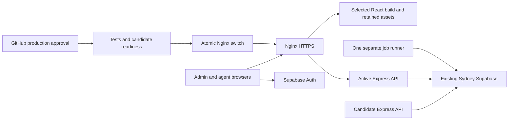

# HD Marketing CRM: production deployment and recovery

Prepared locally on 21 October 2026; updated 22 October 2026 for a **production-only** setup: there is no staging environment (owner decision). No VPS, DNS, GitHub settings, Supabase records or live environment was changed. No commit, push or deployment was performed. This guide replaces the older Caddy deployment path for new installations; do not run Caddy and Nginx on the same public ports.

The complete [file-by-file change inventory](docs/PRODUCTION_FILES.md) describes every addition and edit.

Read [the architecture/risk audit](docs/PRODUCTION_AUDIT.md) and [verification record](docs/PRODUCTION_VERIFICATION.md) before launch. The working application is React/Vite + Express + one background-job process, backed by the **existing Sydney Supabase project**. Keep its project, region, identities, data, grants and RLS. The backend is JavaScript; there is no separate compilation step.



## 1. Safety and command scope

**Safe locally now**, from `hd-marketing-crm`:

```sh
npm test
VITE_SUPABASE_URL=https://ci-fixture.supabase.co VITE_SUPABASE_ANON_KEY=public-ci-fixture VITE_API_URL=/api npm run build
python3 deploy/production/check.py
python3 -m unittest discover -s deploy/production/tests -v
npm audit --audit-level=high
```

Tests use local fixtures; do not run `setup:dev`, `verify:live`, benchmarks, migration bundles, SQL cleanup/repair scripts or root `npm run dev` against production. Development starts a job runner which can perform real retention/deletion work if pointed at production.

**Everything below is an owner-run future infrastructure action, not permission for an assistant to execute it now.** Replace example hostnames/IPs. Never paste private keys, database passwords or service-role keys into chat or commits. SQL changes and restores need separate explicit approval and a tested backup. Release scripts contain no database migration/reset/seed command.

## 2. Location and capacity

Purchase Ubuntu 24.04 LTS KVM 2 only after checking the currently available **VPS** locations. For Pakistan users and Sydney database traffic, start by measuring the available Malaysia/India routes; choose the best measured API-to-Sydney plus user-to-API latency. Singapore may be offered for other hosting products without being a VPS choice. Do not move the existing database to improve latency. Hostinger says VPS location is fixed at initial setup: [official locations](https://www.hostinger.com/support/1583267-where-are-hostinger-servers-located/).

Build and run tests on GitHub-hosted Ubuntu runners, not on the 2-vCPU server. Budget roughly two 750-MB API processes during rollout, one worker, Nginx/OS and transient npm/upload memory; actual RSS can exceed the PM2 restart threshold. Keep at least 2 GB free and 20% disk free, measure large spreadsheet imports and concurrent exports. Stagger backups and releases. One KVM 2 is a single host, not high availability.

## 3. Ubuntu, SSH, firewall and packages

On the new VPS as its owner/admin (keep the provider console and current SSH session open):

```sh
sudo apt update
sudo apt upgrade
sudo apt install nginx certbot python3 curl ca-certificates xz-utils git rsync ufw age cron unattended-upgrades
sudo timedatectl set-timezone UTC
sudo adduser --disabled-password --gecos '' crm-prod
sudo install -d -o crm-prod -g crm-prod -m 700 /home/crm-prod/.ssh
sudo install -d -o crm-prod -g crm-prod -m 755 /srv/hd-crm/production
sudo -u crm-prod mkdir -p /srv/hd-crm/production/releases /srv/hd-crm/production/assets
sudo install -d -o root -g crm-prod -m 750 /etc/hd-crm/production
sudo loginctl enable-linger crm-prod
```

Install the deploy public key in `crm-prod`'s `authorized_keys`, owned by that user and mode 600. Prefix its line with `restrict` to disable forwarding, PTY, agent and X11 forwarding while permitting deployment commands. Do not give this user general sudo. GitHub-hosted runners have changing IPs: don't invent a fixed allowlist. Verify server SSH fingerprints through the provider console; store the verified known-hosts lines in GitHub, never trust a runtime `ssh-keyscan` result without verification.

After testing a second key-authenticated **administrator** SSH session, use a root-owned `/etc/ssh/sshd_config.d/60-hd-crm.conf`:

```text
PasswordAuthentication no
KbdInteractiveAuthentication no
PermitRootLogin no
PubkeyAuthentication yes
```

```sh
sudo sshd -t
sudo systemctl reload ssh
sudo ufw allow OpenSSH
sudo ufw allow 'Nginx Full'
sudo ufw enable
sudo ufw status verbose
```

If SSH uses a custom port, allow it before enabling UFW. Mirror the policy in the provider firewall. Do not allow 3001, 3101/3102, PostgreSQL, or PM2 publicly. Do not force unattended reboots during work hours; schedule OS/Node maintenance separately from application releases.

## 4. Install Node and PM2

Copy/review the repository on the new server as the owner. The following command assumes the current directory is the repository root. It installs the latest patched official Node 24 archive for the machine and verifies its published checksum; review this privileged installer before running it. CI also uses Node 24. The local preparation used Node 24.12.0; future patches must pass CI. [Node release schedule](https://github.com/nodejs/Release).

```sh
sudo bash deploy/production/install-node.sh
node --version
sudo npm install --global pm2@6
pm2 --version
sudo env PATH=/usr/local/bin:/usr/bin:/bin pm2 startup systemd -u crm-prod --hp /home/crm-prod
```

Record exact Node/PM2 versions in the operations log. PM2 runs as the application user, not root. The slot-specific ecosystem starts **only the API**; one jobs process is managed separately. API crashes restart with backoff and memory limits. A PM2 memory restart can interrupt work once the drain deadline expires, so investigate memory pressure instead of treating restart as a fix.

## 5. Private environment and session continuity

Create `/etc/hd-crm/production/server.env` from `deploy/production/production.env.example` using `sudoedit`. It uses `NODE_ENV=production`. Set the matching HTTPS frontend origin, service-role key and Supabase URL. Preserve the existing production `ACCOUNTS_PIN_PEPPER`, OTP secret and Meta token encryption key, as applicable. Copy optional SMTP/Resend, login, Meta and retention settings from root `.env.example`. Use `CALL_PROVIDER=manual`.

```sh
sudo chown root:crm-prod /etc/hd-crm/production/server.env
sudo chmod 640 /etc/hd-crm/production/server.env
```

Use Node's dotenv parser; do not shell-source these files. Do not place them in releases, PM2 command arguments as literal secrets, artifacts, browser configuration or GitHub logs. PM2's stored process metadata is private too. Back up stable secrets separately and encrypted.

Browser variables are **public**: `VITE_SUPABASE_URL`, `VITE_SUPABASE_ANON_KEY`, `VITE_API_URL=/api`, optionally the idle timeout. The build check rejects privileged keys. Builds bind the public project/origin into `deployment-target.json`; deployment rejects disagreement with the server environment. Both wrongly configured to the same wrong project is still possible: before launch, check that both name the existing CRM Supabase project.

Supabase Auth stores browser sessions using the project-derived storage key. Keeping the same project, browser origin and secrets preserves compatible sessions across releases. Moving from localhost to the new HTTPS hostname requires an initial login; routine updates should not. Configure Supabase Auth Site URL and allowed confirmation/password-reset redirects to the production origin and `/login` as required by existing flows. Do not rotate Auth JWT signing keys as a deployment step. No authentication-cookie changes are needed; the app uses bearer tokens, so don't add cookie-based auth or CORS credential sharing.

## 6. No staging environment

There is no staging environment, staging Supabase project, staging domain or staging workflow. Each release is checked by CI, by the candidate's readiness checks before traffic switches, and by a production smoke checklist with clearly named test records that are deleted afterwards. Database updates are applied by hand only after a read-only preflight and a verified backup (for example [docs/PROPERTY_INVENTORY_RELEASE.md](docs/PROPERTY_INVENTORY_RELEASE.md)). Never run development seed/configuration helpers with production credentials.


## 7. DNS, HTTPS and Nginx

Create an A record for `crm.example.com` to the server IP. Add AAAA only if IPv6/firewall/listeners are correctly configured. Wait for resolution. Before the TLS site exists, obtain certificates during initial setup with port 80 free:

```sh
sudo systemctl stop nginx
sudo certbot certonly --standalone -d crm.example.com
sudo install -d -m 755 /var/www/letsencrypt /etc/nginx/hd-crm
sudo install -o root -g root -m 644 deploy/production/nginx.conf.example /etc/nginx/conf.d/hd-crm-limits.conf
sudo install -o root -g root -m 755 deploy/production/switch.py /usr/local/sbin/hd-crm-switch
```

The certificate is stored under `/etc/letsencrypt/live/crm.example.com/`.

Create root-owned `/etc/nginx/hd-crm/production.conf`, initially containing:

```nginx
location / { return 503; }
```

Copy `deploy/production/site.conf.example` into `/etc/nginx/sites-available/hd-crm`; replace the hostname. Keep the certificate path. Link into sites-enabled:

```sh
sudo ln -s /etc/nginx/sites-available/hd-crm /etc/nginx/sites-enabled/hd-crm
sudo nginx -t
sudo systemctl start nginx
sudo systemctl enable nginx
sudo certbot reconfigure --cert-name crm.example.com --webroot -w /var/www/letsencrypt
sudo certbot renew --dry-run
```

Install a root-owned executable renewal hook `/etc/letsencrypt/renewal-hooks/deploy/reload-nginx` containing `#!/bin/sh` followed by `/usr/sbin/nginx -t && /bin/systemctl reload nginx`. Confirm certbot.timer is enabled. Renewal must use webroot after initial setup, not stop the live proxy.

The switch helper generates only validated environment/SHA/slot configurations, atomically replaces the active include, runs `nginx -t`, reloads gracefully, and restores the old include if either command fails. It serializes root switches with a kernel lock. Install this helper once as root; do not grant sudo to a mutable repository script. Updates to this helper require a separate owner review/install.

Using `sudo visudo -f /etc/sudoers.d/hd-crm-switch`, permit only:

```sudoers
crm-prod ALL=(root) NOPASSWD: /usr/local/sbin/hd-crm-switch production *
```

The helper additionally validates argument count, SHA, slot and SUDO_USER. Do not grant generic `systemctl`, shells, editors, file-copy tools or `nginx -c` sudo privileges. Nginx root config/include directories must remain root-owned and not writable by application users.

As `crm-prod`, set the public probe origin (replace the value):

```sh
sudo -u crm-prod sh -c 'printf "%s\n" "https://crm.example.com" > /srv/hd-crm/production/origin'
```

## 8. GitHub configuration and release flow

The repository root containing package.json must be the GitHub checkout root (not its parent backup directory). Workflows use main as the integration branch because that is the existing branch. Protect main with pull-request review and the `CI / validate` status check. Every push and pull request (including pushes to main) runs CI: tests, build, syntax/secret-pattern checks, the release-workflow policy, rollback tests and dependency audit. **Nothing deploys automatically.** `deploy/production/workflow_policy.py` fails CI if any workflow could deploy on a push, schedule or other automatic trigger, skip the CI evidence, or refer to staging.

Create the GitHub environment **production** before the first release (no staging environment). A workflow file cannot create these settings; configure them in the repository settings:

- **Required reviewers:** add yourself. With a single maintainer, do not block self-review or no release can be approved. The release job checks that GitHub recorded an approval for `production` on that run and stops before any secret is used if it did not, so an environment without reviewers, one GitHub created automatically because it was missing, or an administrator bypass cannot deploy.
- **Deployment branches and tags:** selected branches, `main` only.
- **Secrets and variables** below as *environment* secrets and variables, never repository secrets, so a workflow on any other branch cannot read them.

The repository is public (since 23 October 2026), so GitHub offers these settings on every plan. If it is ever made private again, GitHub's documentation says required reviewers on a private repository are not available on the Free, Pro or Team plans, and the Production workflow then cannot deploy; do not weaken the approval check to get around it. [GitHub deployment environments](https://docs.github.com/en/actions/reference/workflows-and-actions/deployments-and-environments).

Because the repository is public, anyone can read its code, full history and Actions logs. Never commit or print private values. In Settings → Code security, enable secret scanning and push protection. In Settings → Actions → General, require approval before running workflows from outside contributors.

In the production environment configure:

| Kind | Name | Value |
|---|---|---|
| Secret | DEPLOY_SSH_KEY | Deploy private key for `crm-prod` |
| Secret | DEPLOY_KNOWN_HOSTS | Verified server host-key lines |
| Variable | DEPLOY_HOST | VPS DNS name or IPv4 address, no URL/port |
| Variable | DEPLOY_USER | crm-prod |
| Variable | FRONTEND_ORIGIN | Exact HTTPS frontend origin without trailing slash |
| Variable | VITE_SUPABASE_URL | Matching public project URL without trailing slash |
| Variable | VITE_SUPABASE_ANON_KEY | Matching public anon/publishable key |

Do not store service-role or DB credentials in GitHub for this workflow. The remote deployment user inherently has application-level access to its own server secrets: protect its SSH key as a production credential. SSH defaults to port 22; adjust the reviewed script if your server uses another port.

The owner must explicitly authorize any future commit/push; none occurred during preparation. Thereafter:

1. Work on a feature branch; push; inspect CI. Open a PR and review schema/API compatibility.
2. Merge to main. CI runs again on that exact commit; nothing is deployed.
3. Apply any approved database update by hand first (read-only preflight, verified backup, SQL Editor), following that release's runbook. Release scripts never run SQL.
4. Open Actions → **Production** → Run workflow on main. Enter the full 40-character SHA of that main commit. The workflow refuses to continue unless the commit is part of main and CI succeeded for that exact commit on main.
5. Approve the release job when GitHub asks (production environment). Without a recorded approval it stops. It checks out the same commit, confirms the checkout is that commit, re-tests it and builds with the production public values.
6. Release jobs upload an archive containing tracked source and built frontend, excluding local .env files. The server installs runtime dependencies from the lockfile with install scripts disabled. Failed checks leave current traffic untouched. An Actions concurrency group and server flock serialize deployments; cancellation is disabled. systemd-run keeps the remote release alive if SSH drops.

`npm ci --ignore-scripts` is suitable for current runtime dependencies; reassess when adding packages requiring native install hooks. Actions are pinned to full commit IDs; review updates periodically. Enable GitHub secret scanning/push protection where available; the local pattern scanner is a limited supplemental check, not proof that arbitrary secrets never entered git history.

## 9. First deployment and worker startup

Provision everything above first, including any approved database updates. Bootstrap Nginx intentionally returns 503 until the first healthy release. The API's `/ready` checks database read connectivity and release identity; it does not prove every historical migration, RPC, SMTP integration or worker is correct. `/api/health/ready` remains admin-only and includes worker status; use it after worker startup.

After the first API release, log in as the appropriate user and start its one worker using the actual active SHA:

```sh
cd /srv/hd-crm/production
read -r slot sha < active
bash "releases/$sha/deploy/production/worker.sh" production "$sha"
pm2 status
pm2 save
```

Verify that no old development laptop, legacy PM2 app, cron entry or other server is running jobs against production. The worker performs existing retention/purge tasks; starting it is a deliberate production action. Confirm expected heartbeats in admin System Status, then test PM2 reboot recovery during an agreed initial window.

## 10. Routine blue-green updates and retirement

Production blue/green ports are 3101/3102. Nginx serves static frontend from the selected release and sends APIs to the matching port. Shared immutable `/assets/` keeps previous hashed chunks available to old tabs. Never overwrite an existing SHA directory or modify an active release. Failed SHA directories are kept for diagnosis; quarantine/rename them manually only after proving no process or proxy references them.

The candidate starts separately, passes bounded `/ready` checks, then Nginx switches atomically. Public HTTPS probes verify the active release header and frontend availability for roughly one minute. Failure returns traffic to the prior app; a failed first release returns to the bootstrap 503 configuration. Both APIs remain running for recovery. No SQL is reversed. A process/host SIGKILL or power loss can bypass traps; inspect root include and application state after such an incident.

The old worker remains on its current release during API cutover. Review old-worker/new-API/new-schema compatibility; update the worker separately with `worker.sh` after acceptance. It stops the old worker before starting the new one and waits for its current batch, subject to PM2's 310-second kill deadline. This creates a short background-job pause. If a batch exceeds that deadline, inspect job effects/heartbeats before proceeding; generic external side effects cannot be guaranteed exactly once. Never rely on API rollback to roll back a worker that was upgraded separately.

Retain the previous API at least until your monitored rollback window ends (recommended 24 hours), and longer if long requests or work need it. Before the next release, **manually** retire only the previous slot as the matching user:

```sh
cd /srv/hd-crm/production
flock -n release.lock bash -c '
  read -r current_slot current_sha < active
  read -r old_slot old_sha < previous
  test "$old_slot" != "$current_slot" || exit 1
  pm2 describe "crm-production-$old_slot"
  pm2 stop "crm-production-$old_slot"
  pm2 delete "crm-production-$old_slot"
  pm2 save
'
```

Review the displayed process first; only execute this block after the rollback window and drain checks. Stopping initiates graceful API drain; deleting removes the stopped PM2 registration, **not customer data or release files**. Immediate rollback is unavailable after retirement until that previous process is restarted. The next release refuses to overwrite an occupied slot. This conservative manual retirement is intentional; an occupied slot makes the next release fail safely. Keep assets for at least the longest supported open-tab period (e.g. 30 days); there is no automatic release/asset deletion.

## 11. Active user work and limits

Keep compatible API contracts for both old and new browsers. Do not force logout/page reload on deploy. Avoid coordinated UI/schema breaking changes in a rolling window. Graceful Nginx reload allows accepted requests to finish; old APIs stay alive and explicit stop gives up to five minutes to drain. Proxy request retries are disabled so POSTs aren't replayed by Nginx. Requests, uploads or external transactions exceeding deadlines can still lose their response. There is no absolute zero-downtime guarantee, particularly for host failures or future WebSockets.

Imports commit accepted rows and their batch in one existing database transaction; intentional invalid rows are reported as rejected. A lost response can still mean the transaction committed. **Check Imported Files by filename/time and inspect accepted leads before retrying.** Phone uniqueness prevents duplicate lead phone records but not duplicate import-batch history. No automatic client retry was introduced. A complete durable idempotency ledger/replay API requires a separately reviewed versioned migration and client operation key; this remains an explicit gap if exactly-once import operations are mandatory.

For uncertain lead edits, refresh/read the lead and audit history before resubmitting. Existing SQL locks preserve transaction integrity; they do not universally detect stale browser edits to the same field. Strict concurrent-edit conflict detection needs a reviewed expected-version design. Supabase Storage and database writes are not one distributed transaction; existing reservation/cleanup logic recovers orphaned files. Check cleanup jobs after interrupted uploads. Never reset the database to fix an application deployment.

## 12. Database migration safety

No release script invokes Supabase CLI, psql, pg_restore, setup or seeds. Keep 001–040 history intact; never re-run the bundle on an existing production project. Inventory actual schema/functions/grants with a qualified owner, compare to the source, and maintain a reviewed ledger of applied migration filenames/checksums. The legacy schema version value 26 is not sufficient evidence.

For a proposed 041+ migration: write a versioned SQL file and review table/function/trigger/view/RLS/Storage dependencies, locks, duration and existing rows. Rehearse on a synthetic schema matching production, record query-plan/lock behavior and a count-only backup verification. Apply only after explicit owner approval. Prefer expand → compatible dual-version code → backfill in bounded batches → verify → contract in a later maintenance release. New columns should initially permit old clients; do not rename/drop functions while old APIs or workers call them.

Destructive DDL/data rewrites need a **separate** approved change window, tested encrypted database and object backups, restoration plan and a declared rollback boundary. Do not enable automatic application rollback unless the previous API/worker/browser still works with the resulting schema. These scripts only support backward-compatible releases. Do not use them for incompatible migrations; arrange a separately approved maintenance/forward-fix procedure. Application rollback never undoes schema or data writes. Do not copy personal customer data into test environments for migration rehearsals; private recovery rehearsal environments need restricted access and outbound integrations disabled.

## 13. Backups, recovery and restore testing

Confirm the actual Supabase plan's backup retention/PITR availability and configure it in the dashboard. Do not assume a paid feature exists. Supabase database backups exclude Storage object bytes: [official backup scope](https://supabase.com/docs/guides/platform/backups).

Existing reviewed tools: `deploy/backup.mjs` (encrypted database), `deploy/backup-files.mjs` (encrypted Storage objects), `deploy/backup.env.example`, `deploy/restore.md`, `docs/BACKUPS.md`. Install a compatible PostgreSQL client for the provider's database major version and age. Store the backup connection/recipient in a private file readable only by a dedicated backup operator. The age decryption identity stays offline with the owner. Do not give CI the backup DB password or decryption key.

After explicit owner authorization and database/Storage connectivity verification, run as that backup operator from a retained release:

```sh
node --env-file=/etc/hd-crm/backup.env deploy/backup.mjs
node --env-file=/etc/hd-crm/backup.env deploy/backup-files.mjs
```

Use a dedicated backup role where supported and reviewed; the existing ledger RPC must be writable by that role. Schedule the reviewed tools daily outside peak usage with `flock`, monitor exit status/age/bytes/checksum and upload encrypted archives to independent off-VPS storage. Do not blindly install the legacy cron file whose paths differ. Keep database/object backups and stable secret/configuration copies together in the recovery inventory, with independent encrypted retention. The existing tools prune old local archives after successful runs; review their retention before enabling them.

Initial planning targets: daily backup RPO up to 24 hours without verified PITR; RTO is unknown until a restore is timed. More frequent recovery requires an explicitly verified backup/PITR plan. Monthly, verify off-site downloads/checksums, decrypt on a trusted isolated machine, list the archive, and restore into a **separate recovery project**, following [deploy/restore.md](deploy/restore.md). Verify row counts, identities, grants/RLS, private files, photo/download functionality and login. Disable jobs/email/Meta during rehearsal. Record recovery time and missing dependencies. Never run restore commands against the existing Sydney project during an application rollback.

## 14. Monitoring and alerts

As each deployment user:

```sh
pm2 status
pm2 logs --lines 100 --nostream
pm2 monit
pm2 install pm2-logrotate
pm2 set pm2-logrotate:max_size 10M
pm2 set pm2-logrotate:retain 14
pm2 set pm2-logrotate:compress true
pm2 save
```

Keep PM2 logs and home private (700); logs may include old job messages. API request logs contain event, request ID, method, status, duration and release only, without bodies, URLs, IPs or credentials. Existing background/audit logging remains. Nginx access format excludes sensitive query strings; error logs can contain paths, so restrict access and review retention. Ubuntu Nginx package logrotate should cover the new `/var/log/nginx/*.log` files; confirm with `sudo logrotate --debug /etc/logrotate.d/nginx`.

Register external HTTPS `/health` and frontend checks every minute; alert to an owner-controlled channel after consecutive failures. This endpoint is liveness only. Add an authenticated monitoring check for `/api/health/ready` with a protected admin session and renewal procedure, or inspect it daily in the CRM until such monitoring is deployed. Alert for stale/failed job heartbeats, 5xx rates, PM2 restarts, p95 latency, backup age >26 hours, missing object backups, disk >80%, memory >80%, sustained CPU >85%, certificate expiry <21 days and host uptime loss. Configure thresholds from measured traffic; these starting values are not capacity guarantees.

Enable GitHub Actions failure notifications for owners and confirm one arrives (for example from a failing CI run on a feature branch). Workflow summaries expose failed deployment status but do not themselves send external alerts. No Slack/email integration was configured. Configure provider CPU/RAM/disk charts or a separate monitoring agent; don't run heavy monitoring databases on KVM 2. Basic diagnostics: `free -h`, `df -h`, `uptime`, `journalctl -u nginx`, PM2 status and the CRM System Status page. Do not paste secret-bearing logs publicly.

## 15. Emergency application rollback

As crm-prod, while the previous process is still healthy and the database/worker remains compatible:

```sh
cd /srv/hd-crm/production
read -r current_slot current_sha < active
bash "releases/$current_sha/deploy/production/release.sh" rollback production
```

This uses the same lock, readiness, atomic Nginx switch and public monitoring as deployment and swaps the previous/active records. If a retired previous process needs restarting, read `previous`, inspect its release and compatible configuration, then:

```sh
read -r previous_slot previous_sha < previous
cd "releases/$previous_sha"
DEPLOY_ENV=production DEPLOY_SLOT="$previous_slot" pm2 start deploy/production/ecosystem.config.cjs
```

Then rerun the rollback command from the environment root. Do not restart an old worker automatically. If a worker update caused the incident, stop it gracefully, review its partially completed/external effects, and deploy the approved compatible worker separately. If the database schema is incompatible, pause automatic rollout and use a reviewed forward fix or separately approved recovery procedure.

For failed preparation/readiness, live traffic remains on the original app; inspect the candidate's logs and keep the failed release for diagnosis. For a failed cutover, inspect `/etc/nginx/hd-crm/production.conf`, `active`, `previous`, PM2 and HTTPS release headers. After a host/power failure these may disagree: the root include determines which target Nginx loads. An owner can restore a known healthy target with `sudo /usr/local/sbin/hd-crm-switch production FULL_SHA blue` (choose actual slot), then repair the state files under `release.lock`. Never edit the database as a shortcut.

## 16. Required launch acceptance

Before inviting real users: protected production environment configured and tested; frontend and server confirmed to use the existing Supabase project; backup + objects + offline keys restored successfully; domain/TLS renewal and firewall checked; verified private environment; all tests and production build passing; one worker; production smoke checks with clearly named test records, deleted afterwards; genuine slow request and upload during switch; old browser tab loading old chunks; concurrent edit conflict expectations agreed; intentional failed candidate/reload/monitoring rollback; PM2 restart/reboot rehearsal; monitoring failure alert received; measured CPU/RAM/database latency; documented operator and recovery window.

No local test can prove all of this for an unpurchased VPS. Treat unresolved idempotency, stale-edit detection, per-user counter continuity and external-operation timeouts explicitly in the launch decision.
